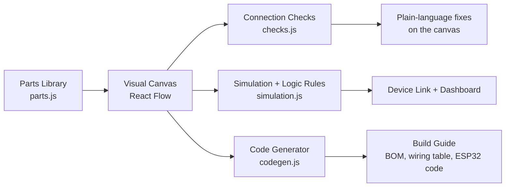
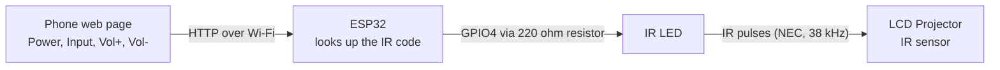

# Circuit Builder: Hardware-Software Project Builder

A beginner-friendly virtual workspace where students can plan, wire, check, simulate and document ESP32 hardware-plus-software projects before spending money on physical parts.

## The Problem

Many college students want to build embedded, IoT and robotics projects, but getting started is hard. Components cost money, students may not know which parts are suitable, and wrong wiring takes time to find and fix. Repeatedly buying parts or rebuilding a circuit makes experimenting expensive and discouraging.

## The Solution

Circuit Builder supports the whole early development workflow in one place: choose components, connect them on a visual canvas, get plain-language explanations of wiring mistakes, test the logic virtually, and see the hardware data appear on a software dashboard. When the circuit is ready, it generates the ESP32 firmware for it.

## How It Works



## Example Project: Phone-Controlled LCD Projector

The app includes a complete example that can be designed, checked and demonstrated without any hardware. A phone web page sends commands over Wi-Fi to an ESP32, which sends infrared (IR) remote-control signals to an LCD projector.



**Wiring:** ESP32 GPIO4, then a 220 ohm resistor, then the IR LED anode (+). The IR LED cathode (-) goes to ESP32 GND. The IR Beam pin of the IR LED points at the IR Sensor of the projector.

What is included:

- **Parts:** IR LED (transmitter), IR Receiver (VS1838B) and LCD Projector in the parts library.
- **Projector Demo tab:** a phone-style remote, a step-by-step signal path, an activity log and a virtual projector that reacts to Power, Input and Volume commands.
- **Wiring checks:** the IR LED needs a resistor, correct polarity and an output-capable GPIO pin. The IR Beam and the projector sensor carry light, not electricity, so wiring them to an electrical pin is flagged.
- **Generated firmware:** when a correctly wired projector circuit is on the canvas, the Build Guide generates a complete ESP32 program (Wi-Fi, phone web page and IR sending) using the GPIO pin you wired.
- **Ready-to-use sketch:** `arduino/projector_controller/projector_controller.ino`. It needs the IRremote library (version 4.x) in the Arduino IDE.

**Honest status:** the circuit design, checks and demo run fully in the browser. The Arduino sketch has not been tested on a physical board yet. The IR codes in the demo and the sketch are examples. A real projector needs its own codes, which can be captured from its original remote with an IR receiver, and compatibility varies by projector model.

## Features

- **Parts Library and Component Guide:** ESP32, LED, resistor, push button, DHT22, HC-SR04, potentiometer, water level sensor, piezo buzzer, IR LED, IR receiver and LCD projector, each with a description, typical uses, operating voltage and a pin table.
- **Visual Wiring Canvas:** add parts, drag them around, and draw or delete wires between pins.
- **Smart Connection Checks:** rule-based checks flag short circuits, clashing pins, missing power or ground, LEDs and IR LEDs without resistors, analog sensors on the wrong ADC pins, outputs driven from input-only pins (GPIO34 and GPIO35), and 5V signals going into 3.3V pins. Each issue explains how to fix it, and problem wires turn red or orange.
- **Hardware Helper:** describe a project goal (for example "water level monitor") and get a recommended parts list with reasons, then add the parts and auto-wire a correct example circuit.
- **Simulation:** control virtual sensors with sliders, build IF-THEN logic rules, and watch LEDs and buzzers react live.
- **Projector Demo:** a full simulated phone-to-projector control chain (see the example project above).
- **Device Link:** unified hardware-software data pipeline supporting built-in simulated ESP32 telemetry or real ESP32 boards via Web Serial (USB) at 115200 baud with a live Serial Monitor.
- **Live Dashboard:** a web-dashboard view fed by the simulation, with sensor cards, charts, editable alert thresholds, actuator states and a JSON data feed.
- **Build Guide:** generates a bill of materials, a wiring schedule, a schematic diagram, ESP32 Arduino code and a safety checklist, with Copy code, Download (.md) and Print / Save as PDF buttons.
- **Save and Load:** the project autosaves in the browser and can be saved to or loaded from a .json file.

## Tech Stack

- React
- Vite
- React Flow (@xyflow/react)
- Arduino C++ for ESP32 (generated firmware, IRremote library for the projector example)

## Getting Started

Requirements: Node.js (LTS version) and npm.

```
git clone https://github.com/Srijakarthikeyan/circuit-builder.git
cd circuit-builder
npm install
npm run dev
```

Then open the address shown in the terminal (usually http://localhost:5173).

## How to Use

1. Open the **Hardware Helper** tab, choose an example such as "ESP32 Water Level Monitor", then click "Add parts to canvas" and "Auto-wire suggested connections".
2. Open the **Build** tab to see the circuit and the Connection Checks. Try making a wrong wire to see the checks explain the mistake.
3. Open the **Simulate** tab, click Start, move the sensor sliders and watch the outputs react to your logic rules.
4. Open the **Dashboard** tab to see the live sensor data and the JSON feed.
5. Open the **Build Guide** tab to get the parts list, wiring table and ESP32 code for building the real prototype.
6. To try the projector example, add an ESP32, a resistor, an IR LED and an LCD Projector on the **Build** tab, wire them as described above, then open the **Projector Demo** tab.

## Project Structure

```
src/
  App.jsx                      Main app, tabs and shared circuit state
  parts.js                     Parts library definitions
  checks.js                    Rule-based wiring checks
  helper.js                    Project templates for the Hardware Helper
  simulation.js                Simulation logic and wiring status per part
  codegen.js                   ESP32 Arduino code generator
  deviceLink.js                Device Link data source (simulated or Web Serial)
  exportGuide.js               Build guide generator
  components/                  Tab and panel components (including ProjectorTab.jsx)
arduino/
  projector_controller/        ESP32 sketch for the phone-controlled projector
```

## Important Limitations

Circuit Builder is a learning tool. Its checks are rule-based and its simulation covers only simple logic and sensor values. It does not model real electrical behavior, timing, noise or sensor accuracy, and it cannot guarantee that a real circuit will work. Always check voltages, wire with the board unplugged, and verify on real hardware safely.

For the projector example specifically: the IR codes are examples, a plain GPIO pin with a resistor gives only a short IR range, and results depend on the exact projector model.

## Roadmap

- Test the projector firmware on a real ESP32 and capture the real IR codes from a projector remote with the IR receiver
- More boards and parts
- A resistor-aware check for button pull-ups and pull-downs
- Connecting the virtual hardware to a real web dashboard over WiFi
- Integration with an existing circuit simulation engine
- Possible ideas: MicroPython export next to Arduino, and I2C parts with pull-up resistor checks

## Author

Built by Srija (GitHub: Srijakarthikeyan).
